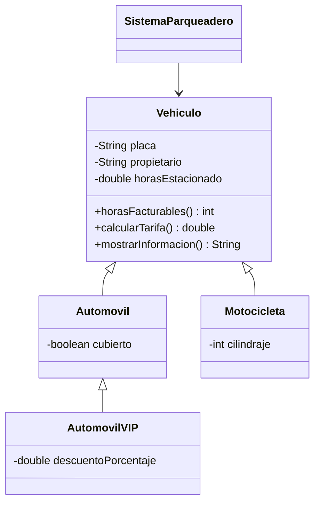

# Estacionamiento Inteligente — Showcase de POO en Java

Ejercicio de repaso

## Contenidos

- Clases, objetos, `private`, getters, setters y validaciones.
- Constructores, `this`, `super`, sobrecarga y `@Override`.
- Herencia simple y multinivel; polimorfismo con `Vehiculo`.
- Casting implícito (`int` a `double`) y explícito (`double` a `int`).
- Parsing con `Integer.parseInt()` y `Double.parseDouble()`.
- `Math.round()`, `Math.ceil()` y `String.valueOf()`.
- `Scanner.nextLine()`, `switch`, `while`, `HashMap` y `ArrayList`.

## Diagrama de clases



## Tarifas del caso de estudio

- Vehículo base: **$1.50 por hora facturable**.
- Automóvil cubierto: **$2.00 adicionales por estancia**.
- Automóvil VIP: **20 % de descuento por defecto**, o porcentaje configurable.
- Motocicleta: **$0.75 por hora facturable**.
- Las horas se cobran por unidades completas: `2.3` horas equivale a `3` horas facturables.

> Las tarifas y datos son ficticios y exclusivamente didácticos.

## Requisitos

Java JDK 17 o superior (no requiere Maven, Gradle ni librerías externas).

## Compilar y ejecutar

Desde la raíz del repositorio:

```bash
mkdir -p out
javac -encoding UTF-8 -d out src/main/java/ec/edu/epn/estacionamiento/*.java
java -cp out ec.edu.epn.estacionamiento.SistemaParqueadero
```

Para ejecutar los ejemplos de conversiones:

```bash
java -cp out ec.edu.epn.estacionamiento.DemoConversiones
```

En IntelliJ IDEA: **Open** → seleccionar carpeta del proyecto → configurar JDK 17+ → ejecutar `SistemaParqueadero.main()` o `DemoConversiones.main()`.

## Ejemplo de ejecución

1. Registrar automóvil `ABC123`, 2.3 horas, cubierto → 3 horas facturables, **$6.50**.
2. Registrar motocicleta `MOT456`, 2 horas, 150 cc → **$1.50**.
3. Registrar VIP `VIP789`, 3.2 horas, sin cubierta → 4 horas facturables, descuento 20 %, **$4.80**.
4. Consultar cada placa.
5. Registrar salida de los tres y consultar ingresos → **$12.80**.

## Estructura

```text
src/main/java/ec/edu/epn/estacionamiento/
├── Vehiculo.java
├── Automovil.java
├── AutomovilVIP.java
├── Motocicleta.java
├── SistemaParqueadero.java
└── DemoConversiones.java
docs/
└── GUIA_DOCENTE.md
```

## Privacidad

Este repositorio es un ejemplo original de estacionamiento. No contiene documentos de evaluación, preguntas, soluciones ni material confidencial.

## Uso

Material de apoyo académico para demostración en vivo.
